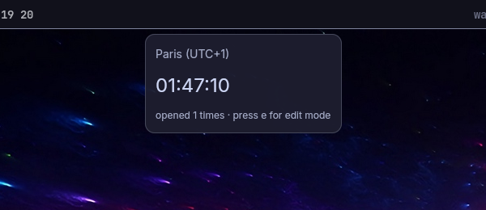

# waybar-gpui

Write a [GPUI](https://www.gpui.rs) panel in Rust; click a Waybar bar module on
Hyprland and it opens as a popover next to the bar.



`waybar_gpui` is an SDK: your own program depends on it, registers its panels
and hands over the command line. The SDK's runtime does the rest: the
background daemon, placing the popover next to the clicked bar module, closing
it on Esc or a click outside, and keeping one popover open at a time across
every program that uses it.

## Quickstart

Requirements: Hyprland (tested with 0.56), Waybar, Rust 1.95+, a Vulkan driver,
and [cargo-generate](https://github.com/cargo-generate/cargo-generate)
(`cargo install cargo-generate`).

```sh
cargo generate --git https://github.com/Cerclique/waybar-gpui template --tag v0.1.0
cd my-panels                         # the project name you gave
cargo run -- preview hello           # the Hello panel at your cursor; Esc closes it
cargo install --path . --locked      # into ~/.cargo/bin
my-panels                            # prints the on-click line for each panel
```

Add a bar module to `~/.config/waybar/config.jsonc` with that line, then
reload Waybar (`pkill -SIGUSR2 waybar`):

```jsonc
"custom/hello": {
  "exec": "echo hello",
  "interval": "once",
  "exec-on-event": false,
  "on-click": "~/.cargo/bin/my-panels toggle hello",
},
```

Click it. No cargo-generate? Copy the [`template/`](template) folder and
replace the `{{…}}` placeholders by hand.

## Documentation

- [The guide](docs/guide/index.md): writing panels, live data, theming,
  widgets, the dev loop, installing, limits, troubleshooting.
- [Using a waybar-gpui program](docs/guide/using-a-program.md): for people
  who install a program built with it.
- Rustdoc: `cargo doc --open` in your project.
- [Example panels](crates/example-panels/src/main.rs): one runnable panel per
  pattern.

## This repository

| Path | What |
|---|---|
| `crates/waybar_gpui` | The SDK (and the runtime, private inside it). |
| `crates/example-panels` | A program built on the SDK the way yours would be; `waybar/` holds the test bars `make dev` runs. |
| `crates/module` | `waybar-hypr-ws`, an example `custom/*` bar module (active Hyprland workspace). |
| `crates/hypr` | Minimal Hyprland IPC used by the runtime and the examples; internal. |
| `template/` | The cargo-generate starter. |
| `scripts/` | `check-template.sh`, shared by CI and `make check-template`. |
| `docs/` | The guide, the [spec](docs/spec.md), the [architecture](docs/architecture.md) and ADRs. |

```sh
make dev              # a second Waybar (top + left bars) wired to example-panels; Ctrl-C stops it
make test             # unit tests and doctests
make lint             # clippy without and with --all-features, cargo doc -D warnings
make check-template   # the starter template, as CI checks it (needs cargo-generate)
```

## Versions

A git dependency with `vX.Y.Z` tags, not on crates.io: GPUI is pre-1.0, pinned
exactly (`gpui-pre =0.3.9`). 0.x semver; every GPUI pin change is a breaking
release. Details: [Limits](docs/guide/limits.md#versions).

## Contributing

Start with [CONTRIBUTING](docs/CONTRIBUTING.md) and the
[Code of Conduct](docs/CODE_OF_CONDUCT.md). Report vulnerabilities privately:
[SECURITY](docs/SECURITY.md). MIT licensed: [LICENSE](LICENSE).
