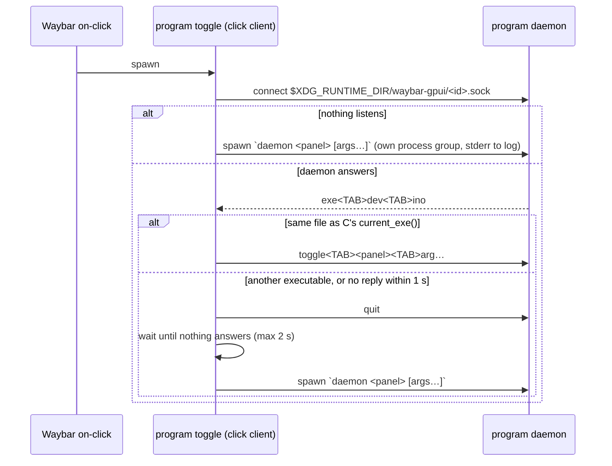

# Architecture

For contributors changing the runtime inside `crates/waybar_gpui`. It describes
what the code does today and why. Terms follow [`GLOSSARY.md`](GLOSSARY.md);
the decisions behind it come from the tickets of the
[map](https://github.com/Cerclique/waybar-gpui/issues/7), which keep the
alternatives rejected and why; the three decisions that are hardest to reverse are
recorded as ADRs in `docs/adr/`
([0001](adr/0001-full-monitor-surface-with-drawn-card.md),
[0002](adr/0002-daemon-per-program.md),
[0003](adr/0003-no-gpui-component-root.md)).

| File | What it owns |
|---|---|
| `lib.rs` | Public API: `Panel`, `App`, re-exports. |
| `cli.rs` | argv parsing, usage text, dispatching each command to `client.rs` or `runtime.rs`. |
| `client.rs` | The click client: making sure a daemon of *this* program receives `toggle`, `close` or `quit`. Behind `toggle`: comparing the daemon's identity with its own, replacing a daemon of another executable (`quit`, wait for it to go, start ours) and starting one when none runs. The seam is `Executable` (its identity, starting its daemon): `CurrentExe` re-runs `current_exe() daemon <panel> [args…]` detached with stderr appended to the log; tests start fake daemons in a temp directory. |
| `files.rs` | What a program owns on disk: `ProgramFiles` (socket directory, socket, lock and log paths, resolved once from `XDG_RUNTIME_DIR`, `XDG_STATE_HOME` and `HOME`, the only place reading them), and the daemon taking ownership (`claim`: lock, check, remove a stale socket, bind, claim the log, serve) and giving it up (`Ownership::give_up` removes the socket on `quit`); closing other programs' popovers (`close_others`: scanning the socket directory, deleting stale sockets). Everything that touches the shared directory is here. |
| `panels.rs` | `Panels`: the registered panels, the one place a panel is looked up by name (`cli.rs` to check a command line and print the usage, `runtime.rs` to build it) and a duplicate name is rejected. |
| `ipc.rs` | Line protocol, `Target` (a panel name and its arguments), daemon identity (`ExeId`), and its two ends: `Connection` (the client's, to a socket path) and `serve` (the daemon's, on a bound socket). It knows no paths or directories; `files.rs` depends on it, not the reverse. |
| `popovers.rs` | The popover rules without GPUI: what a toggle, `close`, `quit` or a dismissal does, and when the process quits. Returns effects; unit-tested. |
| `runtime.rs` | The GPUI side: `daemon` and `preview` (a `Session` holds what each needs: the daemon's `Ownership`, the preview's failure for its exit status), carrying out `popovers.rs`'s effects, the popover surface, focus, dismissal. |
| `placement.rs` | Monitor and bar-edge detection, the anchor point and margins. |
| `hypr.rs` | Hyprland IPC: the `j/cursorpos` and `j/monitors` requests `placement.rs` reads. Private, not re-exported. |
| `theme.rs` | `Theme`, `card()`, copying `Theme` into gpui-component's theme. |

## Process model

Every program runs its own runtime. One executable plays two roles, picked by
argv in `cli.rs`:

- **Click client** (`client.rs`): `toggle <panel> [args…]`, `close`, `quit`.
  Short-lived: connects to the program's socket, sends one command, exits.
  Panel names are checked against the registered panels in `cli.rs` before
  anything is sent; usage errors exit with status 2. `close` and `quit` with
  no daemon succeed and do nothing.
- **Daemon:** `daemon [<panel> [args…]]`. Binds the socket, runs GPUI with
  `QuitMode::Explicit` so closing the last popover doesn't exit, and stays warm
  (GPU device and fonts loaded) until `quit` or logout. `toggle` starts it when
  no daemon answers (socket missing or refusing the connection) as
  `current_exe() daemon <panel> [args…]`, in its own process group
  (`process_group(0)`) with stdin and stdout null, so a Waybar reload killing
  its `on-click` children doesn't take the daemon with it.
- **`preview <panel> [args…]`:** the same GPUI runtime without the socket. It
  opens the panel at once, logs to the terminal, and quits when the popover
  closes (exit status 1 if the panel couldn't open). It never displaces the
  daemon, but before opening it sends `close` to every socket, its own
  program's included, so the one-popover rule holds.

A daemon takes ownership of its program's files through `ProgramFiles::claim`
(`files.rs`). It refuses to start (`daemon already running`) if another daemon
already answers on its socket; otherwise it removes the stale socket file and
binds, doing those three steps holding an advisory lock (`flock`, through
`File::lock`) on `<id>.lock` next to the socket, and releases it once bound.
Daemons started at the same moment (two `toggle`s finding no daemon) take
turns: the first binds, the others then find it answering. Without the lock
they could all pass the check, each removing the socket the previous one
bound, which left orphaned daemons no command reached. The lock covers startup
only: a lifetime lock was tried and broke replacing a daemon from another
build, because the old daemon still held it while it exited. The kernel drops
the lock if the process dies, and the lock file is never removed (removing it
would let two daemons lock different files). On `quit` the daemon gives
ownership up (`Ownership::give_up`): once its popover is closed it removes the
socket, before the event loop stops, so a `toggle` waiting for it to go finds
no daemon at once. A panicking panel takes the daemon down; the next click spawns a fresh one (no `catch_unwind`).

## Socket directory and line protocol

- **Directory:** `$XDG_RUNTIME_DIR/waybar-gpui/` (the system temp directory if
  `XDG_RUNTIME_DIR` is unset), created on demand. `ProgramFiles` resolves it
  once per process, with the socket, lock and log paths. One socket per program,
  `<id>.sock`, named by the program ID. The same ID names the layer namespace
  (`waybar-gpui:<id>`), the log file and the prefix of every log line
  (`<id>: …`). `App::new` rejects IDs outside `^[a-z0-9][a-z0-9-]*$`, so the ID
  is safe in a file name and a namespace.
- **Protocol** (the module doc of `ipc.rs` is the reference): one exchange per
  connection, `\n`-terminated lines of tab-separated words.
  1. On accept the daemon writes its identity, `exe<TAB>dev<TAB>ino`.
  2. The client writes one command, `toggle<TAB>panel<TAB>arg…`, `close` or
     `quit`, and hangs up.

  Panel arguments travel as separate words, so they may contain spaces but not
  tabs or newlines. Clients that don't care who answers (`close`, `quit`, other
  programs) write without reading the identity; the daemon ignores a failed
  identity write and still reads the command. A connection that writes nothing
  (the `wait_gone` probe) is ignored, and an unknown command is logged and
  dropped. The listener runs on a plain thread and forwards commands to GPUI
  through an `async_channel`.
- **Identity and stale-binary replacement:** at startup the daemon records the
  device and inode of `/proc/self/exe`, which keep naming the file it started
  from even after that file is replaced. `toggle` (`client.rs`) compares them
  with `stat(current_exe())`. A rebuild or `cargo install` writes a new inode, and
  another copy is another file, so on mismatch `toggle` sends `quit`, polls
  until nothing answers (20 ms steps, 2 s limit) and spawns itself. A daemon
  that sends no valid identity within 1 s (one from before the handshake) is
  replaced too. If `toggle` can't stat its own executable it sends the command
  anyway. Consequence, intended: a `target/debug` build and an installed copy
  with the same ID replace each other's daemon, so each click shows its own
  binary's panels. `quit` remains as the escape hatch.
- **Toggle semantics** (`Popovers::on` in `popovers.rs`): if the open popover has the same
  panel and the same panel arguments (an equal `ipc::Target`), close it;
  otherwise close whatever is open and open the new one, built fresh.

## Log file

A spawned daemon's stderr goes to `$XDG_STATE_HOME/waybar-gpui/<id>.log`
(`~/.local/state/…` by default). `toggle` creates the directory and opens the
file for appending; it doesn't truncate it, because two `toggle`s finding no
daemon at the same moment both spawn one, and the loser's truncation would
wipe the winner's log. Instead `ProgramFiles::claim` claims the log right
after binding the socket: the daemon that owns the socket truncates its stderr if
stderr is the log file (same device and inode), so the log covers the running
daemon only. Its descriptor is in append mode, so its next line lands at the
start. A daemon that lost the race never binds and only appends its `daemon
already running` line; a `daemon` run by hand has its stderr elsewhere and
truncates nothing.
stderr *is* the log: runtime lines (`opened … on DP-1 (Top bar)`,
`closed … (escape)`, replacements, stale sockets), the author's `eprintln!` or
any logger they install, and panic messages. The SDK has no logging
dependency. `toggle`'s own errors stay on its stderr, which Waybar logs;
`daemon` and `preview` run by hand log to the terminal.

## Coordination between programs

At most one popover is open across all programs. Before opening, a runtime
(`ProgramFiles::close_others`, `files.rs`) connects to every other `*.sock` in
the directory and writes `close`; a preview, which has no socket, includes its
own program's. Best effort: no lock, no central process, no waiting for
replies. A socket that refuses the connection was left by a crashed program and
is deleted. It takes no lock, not even another program's `<id>.lock`: a daemon
caught between `bind` and `listen` also refuses, and losing its socket file
would orphan it. That window lies between two consecutive syscalls; it is
accepted. Clicking a bar module while any popover is open can't reach Waybar
(see [Hyprland input routing](#hyprland-exclusive-layer-input-routing)), so
this mainly matters for popovers opened from keybinds and scripts, which would
otherwise fight over keyboard focus.

## The popover surface

Each popover is one GPUI window of kind `WindowKind::LayerShell`:

- Overlay layer, anchored to all four edges, sized to the whole monitor
  (logical size from `j/monitors`: physical size ÷ scale, swapped for rotated
  transforms), `exclusive_zone = -1` so it covers the bar instead of being
  pushed off it, `KeyboardInteractivity::Exclusive`, transparent background,
  namespace `waybar-gpui:<id>`, app ID `waybar-gpui-<id>`.
- **Monitor:** the one containing the cursor (`j/cursorpos`), falling back to
  the focused monitor. GPUI's Wayland displays carry
  `Uuid::new_v5(NAMESPACE_DNS, wl_output name)`, so `display_for_monitor`
  computes that UUID from the Hyprland monitor name and picks the matching
  display.
- **Backdrop and card:** the root view (`Popover`) is a full-size `div`, the
  backdrop. The panel is drawn inside a card `div` placed with GPUI's
  `anchored()`. The runtime paints no chrome; `card()` is the panel's choice.
  The card is capped to the usable area (`max_w`/`max_h`); scrolling past that
  is the panel's job.
- **Placement** (`placement.rs`): the bar edge is the reserved edge of the
  monitor (`reserved` from `j/monitors`) nearest the click; with nothing
  reserved (a non-exclusive bar), the nearest edge. The anchor is the middle of
  the card's bar-side edge, 6 px (`GAP`) off the bar: centred on the cursor's x
  for a top or bottom bar (`TopCenter`/`BottomCenter`), on its y for a left or
  right bar (`LeftCenter`/`RightCenter`). `snap_to_window_with_margin` with the
  reserved area plus the gap keeps the card inside the usable area.
  `anchored()` measures the card and positions it in the same frame, so there
  is no first-frame jump and no size declared by the panel; when the content
  grows while open, the card is re-placed on the next layout.

### Focus and Esc

The panel is built inside `open_window` before the `Popover` view exists. If its
`new` focused one of its own elements, `Popover::new` leaves that focus alone,
so the panel's key handlers see Esc first and can keep the popover open with
`cx.stop_propagation()`. Only when nothing is focused does the runtime focus
the backdrop. Esc that bubbles up to the backdrop's `on_key_down` dismisses.

### Dismissal paths

Every close is a `Close` effect from `Popovers` (`popovers.rs`) and logs a
reason. Closes from the popover's own events (the first four rows) are
deferred with `cx.defer`, so nothing removes the window during its own event
dispatch; commands from the socket close at once:

| Path | Reason logged |
|---|---|
| Any mouse button down on the backdrop (left, right, middle, side). The card and any overlay a widget draws (a menu overflowing the card) `.occlude()` it, so those clicks never reach it. The panel can't veto. | `click outside` |
| Mouse down outside the surface's own bounds: a click on another monitor, which Hyprland delivers to this surface with outside coordinates. Tested geometrically in the card's `on_mouse_down_out`, because nothing is hovered for such a click. | `click on another monitor` |
| Esc the panel didn't stop. | `escape` |
| `close(cx)` from the panel. | `panel` |
| `toggle` of the open target, or of another one. | `toggle` |
| `close` command (the CLI, or another program opening). | `close command` |
| `quit` (also removes the socket file). | `quit` |

In `preview`, any close quits the process.

## Hyprland exclusive-layer input routing

The popover's design rests on how Hyprland 0.56.2 routes input to
exclusive-keyboard layer surfaces. Conclusions of
[`docs/research/hyprland-two-exclusive-layers.md`][hypr-research] (read from the
Hyprland source at `v0.56.2`; the click-routing part was then confirmed with
real clicks):

- Hyprland keeps one global, map-ordered list of every mapped
  exclusive-keyboard layer surface (`m_exclusiveLSes`), across monitors,
  layers and clients.
- **Clicks:** the "forced above all" block in `mouseMoveUnified`
  (`InputManager.cpp` L453–465) hit-tests that list newest first, on input
  regions. If no surface is hit (another monitor, a gap), the pointer goes to
  the **oldest** exclusive surface, with coordinates outside its bounds.
  Nothing outside the list can get pointer focus while it is non-empty.
- Hence, while any popover is open, **Waybar can't be clicked**: clicking
  another bar module only dismisses, and a second click opens the new panel.
  The first click outside the card only closes the popover; it never reaches
  the window below.
- Hence also the other-monitor path above: those clicks land on the popover
  with coordinates outside the surface.
- **Keyboard:** the surface mapped last takes focus as it maps. Afterwards
  focus follows the pointer between exclusive layers (`InputManager.cpp`
  L733–736) unless `input:follow_mouse = 3`. The wlr-layer-shell protocol
  leaves two exclusive surfaces "implementation-defined". Windows can't take
  focus back while any exclusive layer is mapped.
- **Third-party exclusive surfaces** (out of scope, accepted): if a launcher
  such as fuzzel opens over a popover, moving the pointer off the launcher
  hands the keyboard back to the popover, and a click there closes the popover
  while the launcher stays open. A later full-output exclusive surface on the
  same monitor (wlogout) takes all input there until it unmaps.

## GPUI constraints

- **Version pin:** `gpui-pre` and `gpui-pre-platform` `=0.3.9` (a community
  snapshot of `zed@93d7456`, lib names still `gpui`/`gpui_platform`), with the
  `wayland` feature only. The official crates.io `gpui` 0.2.2 is a year stale
  and has no layer shell; a git dependency on Zed `main` would need Rust 1.98.1
  while the project targets 1.97.1. The API breaks between snapshots, so check
  the source in `~/.cargo/registry/src/*/gpui-pre-0.3.9/` before using an API.
  `gpui-pre`, `gpui-pre-platform` and `gpui-component` move together, and any
  change to the three is a breaking minor release. Background:
  [`docs/research/gpui-popup-windows.md`](research/gpui-popup-windows.md).
- **gpui-component** (`components` feature): `gpui-component =0.8.0` pins the
  same `gpui-pre =0.3.9`, so Cargo resolves a single GPUI and no `[patch]` is
  needed; it builds on 1.97.1. It is a direct dependency, never the `gpui-kit`
  umbrella, which turns on X11 and runtime shaders. It costs ~110 crates and
  ~10 MB of release binary. With the feature on, the runtime calls
  `gpui_component::init`, registers `gpui-kit-assets` (`with_assets`) for
  widget icons, and copies `Theme`'s colours into gpui-component's theme
  (`ThemeConfig`; gpui-component derives the rest through its fallbacks).
  Conclusions of [`docs/research/gpui-component-compat.md`][component-research].
- **No gpui-component `Root`:** on Linux `Root` always wraps the window in
  `window_border()`, because layer surfaces get client-side decorations. That
  adds a 20 px inset per side plus a shadow, which grew a 1920×1080 surface to
  1960×1120 and veiled the whole output. Without `Root`, menus and in-window
  popovers work; dialogs and notifications don't, and are unsupported. See
  [ADR 0003](adr/0003-no-gpui-component-root.md).
- **Derive macros:** GPUI's derive macros (`gpui-pre-macros 0.3.9`) emit
  hard-coded `gpui::…` paths, rewritten only when `gpui-kit` is a dependency.
  The SDK re-exports `gpui`, so authors write `use waybar_gpui::gpui;` in
  modules using them (shown in `crates/example-panels/src/workspace.rs`).
- **Imports:** `layer_shell::*` and `gpui::*` both export an `Anchor`;
  globbing both is a deny-by-default `ambiguous_glob_imports` error on 1.97.
  `runtime.rs` globs `layer_shell::*` with an explicit `gpui::{…}` list, and
  `placement.rs` names `gpui::Anchor` in full.

## Elsewhere in the repo

- **Hyprland IPC** (`hypr.rs`, and `example-panels`' own copy for the
  workspace panel's events) is hand-rolled instead of the `hyprland` crate,
  whose 0.4 line has been in beta since 2024. The request
  socket (`.socket.sock`) is opened and closed per request: Hyprland serves it
  synchronously and freezes on held connections.
- **Waybar config:** Nerd Font glyphs in
  `crates/example-panels/waybar/config.jsonc` are written as `\uXXXX`
  escapes; pasted glyphs came out as blank icons.

## Rejected designs

Each was tried or considered; details in the tickets of the
[map](https://github.com/Cerclique/waybar-gpui/issues/7).

- **`xdg_popup` attached to Waybar's icon:** a Wayland popup needs a parent
  surface owned by the same client, so another process can't attach one to
  Waybar, and GPUI can't live inside Waybar's GTK process. Only a GPUI-drawn
  bar (like gpui-shell) could anchor a real popover.
  [ADR 0001](adr/0001-full-monitor-surface-with-drawn-card.md).
- **A small layer surface sized to the panel, closing on focus loss:** the
  first design. With `follow_mouse = 1`, moving the pointer onto the popover
  handed focus to the window underneath and it closed within ~300 ms.
- **A separate transparent full-output backdrop surface under the popover:**
  Esc worked, but clicks outside, and on the icon, reached neither the
  backdrop nor Waybar: Hyprland sends every click to the exclusive-keyboard
  layer (the routing above). Replaced by one surface with the card drawn
  inside, which also retired a 300 ms reopen guard.
- **Closing on clicks via hover tests:** clicks from other monitors arrive
  with outside coordinates and nothing hovered; hence the geometric
  `on_mouse_down_out` test.
- **Keeping panels alive and hidden between opens:** stale data and hidden
  background work. Panels are built fresh per open and dropped on close, which
  stops their tasks.
- **A fixed size declared by the panel, plus a resize action:** clips or
  wastes space; `anchored()` measures in the same frame instead.
- **A process per click:** a cold start pays a wgpu/Vulkan device init and
  font loading every time (~400 ms against ~140 ms warm, measured below).
- **A single shared runtime process for all programs:** contradicts the SDK
  being a library each program links. Programs coordinate through the shared
  socket directory instead. [ADR 0002](adr/0002-daemon-per-program.md).
- **Telling a rebuilt binary from the running one by `quit` only, or by
  inotify self-watch:** the per-click identity check costs one `stat` and
  covers rebuilds and `cargo install` alike.
- **CFFI bar modules:** Waybar 0.15.0's CFFI is GTK3-only, runs in Waybar's
  process (a crash takes the bar down), needs a Waybar restart to pick up a
  rebuild, and has a `deinit` check bug (always export `wbcffi_deinit` if CFFI
  is ever added). Bar modules are `custom/*` programs:
  [`docs/research/waybar-custom-modules.md`](research/waybar-custom-modules.md).
- **Wrapping popovers in gpui-component `Root`:** see above and ADR 0003.
- **Catching panics in the daemon, idle exit, a logging crate, journald:**
  rejected in [#19](https://github.com/Cerclique/waybar-gpui/issues/19)
  and [#16](https://github.com/Cerclique/waybar-gpui/issues/16);
  the daemon is cheap to respawn and stderr is the log.

## Verified behaviour

Test machine: Arch, Hyprland 0.56.2 (Lua config), Waybar 0.15.0, Rust 1.97.1,
NVIDIA + Vulkan, two 1920×1080 monitors (DP-2 at x=0, DP-1 at x=1920),
Waybar height 36.

Measured on the pre-SDK daemon (`waybar-popup`, the same single-surface design
before it became `waybar_gpui`); not re-measured since:

- Real clicks: click outside 3/3, icon re-click 4/4, click inside the card
  stays open, Esc 2/2, stays open while the pointer moves, both monitors.
  Clicks on the other monitor close it, confirmed both ways.
- Timings: ~410 ms to draw when the click starts the daemon, 130–150 ms when
  it is warm. From the CLI: ~100 ms cold, under 20 ms warm.
- A 0×0 first open was seen once, with the old focus-loss design; ~27 cold
  starts and four real-click rounds since all drew normally (250–410 ms). If
  the log shows an `opened` line with no visible popover, that is the bug
  back.
- Release sizes: daemon binary 26 MB; the
  `components` feature adds ~10 MB.
- `hyprctl -j layers` showed the surface on the Overlay layer at the expected
  geometry.

On `waybar_gpui`, the API prototype (never merged)
validated with real clicks on top and left bars: `anchored()` placement with no
first-frame jump, Esc reaching a focused panel first, backdrop-only dismissal
with menus overflowing the card, derive macros through `use waybar_gpui::gpui;`,
live data stopping on close, a `Global` surviving a close, and
gpui-component widgets themed from `Theme` without `Root`. A blocking event
reader (Hyprland's socket) keeps its thread until the next event after close.

[hypr-research]: research/hyprland-two-exclusive-layers.md
[component-research]: research/gpui-component-compat.md
