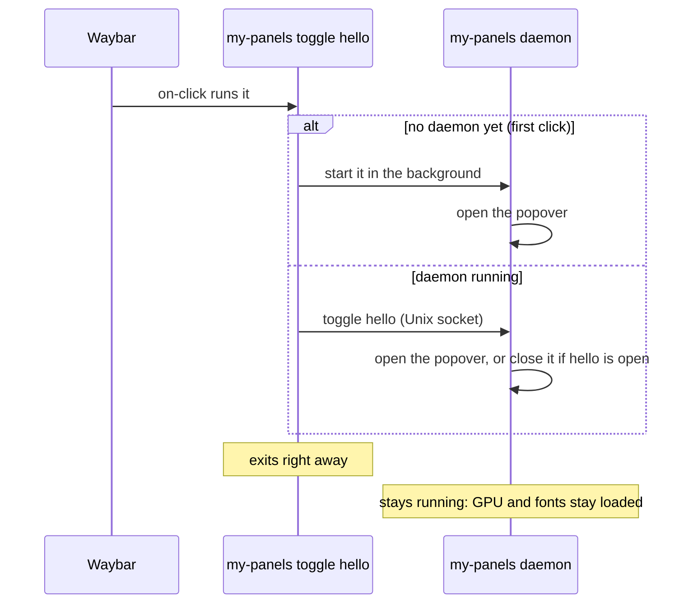

# How it works

What happens between a click and a popover, at the level an author needs to
understand what they see. The full picture, with the reasons and the
evidence, is in [`docs/architecture.md`](../architecture.md).

## One binary, two roles

Your program is both the **click client** and a **daemon**:

- The first click starts the daemon, so it's slower (a few hundred ms); later
  clicks only open a window and are fast.
- The daemon lives until `my-panels quit` or logout. If the binary on disk
  changed (you rebuilt or reinstalled), the next click replaces the daemon.
- The daemon's socket is `$XDG_RUNTIME_DIR/waybar-gpui/<id>.sock`, named by
  your program ID. Every program's socket is in that one directory, which is
  how programs close each other's popovers: at most one is open at a time.

## The popover is a full-screen, transparent layer

Wayland doesn't let one program attach a real popup to another program's
window, so the popover can't hang off Waybar's icon. Instead:

- The popover is a **transparent layer surface covering the whole monitor**
  the click came from, bar included, above everything else.
- Your panel is drawn inside it as the **card**, placed next to the bar:
  centred on the cursor, 6 px off the bar edge, kept inside the screen. Top,
  bottom, left and right bars all work.
- The rest of the surface is the invisible **backdrop**. A click on it closes
  the popover.
- It takes the keyboard exclusively, so Esc always works.

Hyprland sends every click to such a layer while it's open. That's why Waybar
can't be clicked while a popover is open, why the first click outside only
closes it, and why a click on another monitor closes it too. See
[Closing and Esc](closing-and-esc.md).

## Panels are fresh on every open

The daemon builds your panel when the popover opens and drops it when it
closes. Live updates and state that outlives a close are plain GPUI patterns:
[Live data and state](live-data-and-state.md).

## Logs

A daemon started by a click writes its stderr to
`~/.local/state/waybar-gpui/<id>.log`; see [Dev loop](dev-loop.md#logs).
